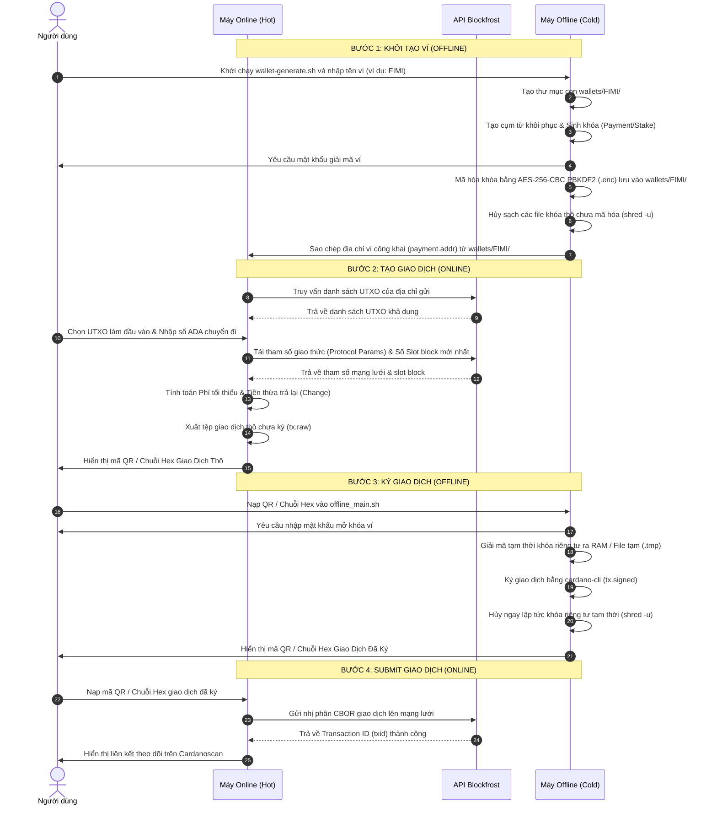

# Quy Trình Giao Dịch & Cơ Chế Bảo Mật Ví Cardano Air-Gap

Tài liệu này mô tả chi tiết quy trình luân chuyển dữ liệu giao dịch từ khâu khởi tạo trực tuyến, ký ngoại tuyến đến gửi lên mạng lưới (Submit), đồng thời giải thích phương thức bảo mật mã hóa khóa riêng tư (Private Key) và cụm từ khôi phục (Seed Phrase).

---

## 1. Biểu Đồ Luồng Hoạt Động (Transaction Workflow)

Dưới đây là sơ đồ Mermaid mô tả trực quan các bước chuyển giao dữ liệu giữa hai môi trường trực tuyến và ngoại tuyến:

---

## 2. Quy Trình Giao Dịch Chi Tiết

### Khởi tạo Giao dịch (Online)
1.  **Truy vấn thông tin**: Máy Online sử dụng API Blockfrost lấy danh sách UTXO khả dụng của địa chỉ ví, tham số giao thức mạng (cho việc tính phí) và số slot hiện tại (để thiết lập thời hạn kết thúc TTL).
2.  **Tính toán mức phí & Tiền thừa**:
    *   Hệ thống dựng giao dịch nháp (draft) với phí = 0.
    *   Sử dụng `cardano-cli conway transaction calculate-min-fee` để tính phí thực tế.
    *   Tính toán tiền thừa trả về (Change). Nếu số dư thừa nhỏ hơn mức tối thiểu (1 ADA), hệ thống sẽ cảnh báo bụi giao dịch (dust) và hỏi người dùng có muốn cộng gộp số dư thừa đó vào phí giao dịch hay không nhằm đảm bảo giao dịch hợp lệ.
3.  **Xuất dữ liệu**: Xuất tệp `tx.raw` và tạo ra mã QR chứa tiền tố nhận diện `TxBodyConway:<chuỗi_hex_CBOR_giao_dịch_thô>`.

### Ký Giao dịch (Offline)
1.  **Tiếp nhận giao dịch**: Máy Offline tiếp nhận dữ liệu thông qua việc quét mã QR bằng webcam, đọc từ file hình ảnh hoặc dán chuỗi hex bằng tay.
2.  **Nhập mật khẩu**: Người dùng cung cấp mật khẩu để giải mã các tệp khóa bảo mật.
3.  **Ký cục bộ**: Sử dụng `cardano-cli conway transaction sign` để ký giao dịch ngoại tuyến hoàn toàn, không cần kết nối mạng.
4.  **Xuất kết quả đã ký**: Xuất ra mã QR và chuỗi văn bản với tiền tố `TxConway:<chuỗi_hex_CBOR_đã_ký>`.

### Submit Giao dịch (Online)
1.  **Nạp giao dịch đã ký**: Máy Online nhận mã QR / Chuỗi Hex đã ký từ máy Offline.
2.  **Submit lên mạng**: Hàm `bf_submit_tx` chuyển đổi chuỗi Hex thành nhị phân CBOR thô và gửi lên Blockfrost thông qua phương thức `POST` tới endpoint `/tx/submit` với header `Content-Type: application/cbor`.
3.  **Xác nhận**: Trả về mã băm giao dịch (TxID) và kết xuất link theo dõi.

---

## 3. Cơ Chế Bảo Mật & Bảo Vệ Seed/Private Key

Bảo mật khóa riêng tư và cụm từ khôi phục (Seed Phrase) là yếu tố sống còn đối với ví ngoại tuyến. Hệ thống thực thi các giải pháp bảo mật sau:

### A. Mã Hóa Chuẩn Quân Sự (Military-Grade Encryption)
Hệ thống sử dụng mật khẩu của người dùng kết hợp công nghệ mật mã của OpenSSL:
*   **Thuật toán mã hóa**: `AES-256-CBC` (Advanced Encryption Standard 256-bit trong chế độ Cipher Block Chaining). Đây là chuẩn mã hóa đối xứng mạnh nhất được khuyến nghị.
*   **Hàm tạo khóa (KDF)**: Sử dụng `PBKDF2` (Password-Based Key Derivation Function 2) cùng thuật toán băm bảo mật cao để chống lại các cuộc tấn công dò mật khẩu (brute-force).
*   **Số vòng lặp băm (Iterations)**: Thiết lập `100,000` vòng lặp trên Bash CLI (OpenSSL) và `50,000` vòng lặp trên Flutter Mobile App (đảm bảo cân bằng giữa kháng GPU brute-force và độ mượt giải mã trên chip ARM).
*   **Mã hóa salt**: Bổ sung cờ `-salt` để tạo ra chuỗi khóa ngẫu nhiên khác nhau cho mỗi lần mã hóa, chống tấn công bảng băm (rainbow table).

### B. Cơ Chế Giải Mã & Khởi Tạo Trên RAM (RAM-disk Isolation)
*   Khóa riêng tư và cụm từ phục hồi thô (chưa mã hóa) chỉ tồn tại dưới dạng thô trong một khoảng thời gian cực ngắn khi thực hiện tác vụ sinh khóa hoặc ký giao dịch.
*   **Không ghi đĩa cứng**: Tất cả các tệp thô tạm thời này được lưu trữ trực tiếp trong thư mục con của `/dev/shm` (được gắn dưới dạng **tmpfs** - hệ thống tệp chỉ chạy trên bộ nhớ RAM). Vì dữ liệu chỉ được ghi lên các ô nhớ volatile RAM, nó hoàn toàn không chạm vào các cung từ (sectors) hay tế bào nhớ flash của ổ đĩa cứng vật lý (HDD/SSD).
*   Nếu hệ thống không hỗ trợ `/dev/shm` (không ghi được RAM disk), mã nguồn sẽ tự động phát hiện và chuyển đổi dự phòng an toàn sang tạo thư mục tạm trong ổ đĩa hiện tại.

### C. Hủy Sạch Dấu Vết Dữ Liệu (Secure Shredding)
Khi xóa các tệp nhạy cảm (sau khi tạo khóa hoặc ký xong giao dịch), các lệnh xóa thông thường (như `rm`) chỉ gỡ liên kết trỏ tới tệp chứ không xóa dữ liệu vật lý. Để đảm bảo an toàn tuyệt đối, hệ thống thực hiện:
*   Sử dụng lệnh **`shred -u`**: Tiến hành ghi đè dữ liệu rác ngẫu nhiên đè lên vùng nhớ chứa khóa nhiều lần trước khi xóa bỏ liên kết tệp. Việc này được thực hiện trên RAM (hoặc ổ cứng dự phòng) để xóa sạch mọi vết tích nhị phân.
*   Bảo vệ an toàn bằng cấu trúc `trap` trong Bash để tự động kích hoạt hàm dọn dẹp và hủy khóa thô ngay cả khi người dùng đột ngột tắt script hoặc chương trình gặp sự cố (Crash) bất ngờ.

### D. Cơ Chế Hiển Thị Cụm Từ Khôi Phục Bảo Mật (Paged Mnemonic Display)
*   **Hiển thị phân trang bảo vệ rò rỉ hình ảnh**: Khi người dùng tạo mới ví hoặc yêu cầu xem lại 24 từ khôi phục từ tệp `phrase.prv.enc` (sau khi xác thực mật khẩu giải mã thành công), cụm 24 từ được hiển thị dạng bảng chuẩn 4 từ/hàng và chỉ hiển thị tối đa 3 hàng (12 từ) trong 1 trang. Người dùng cần nhấn ENTER để chuyển sang 12 từ tiếp theo. Điều này ngăn ngừa việc màn hình hiển thị toàn bộ 24 từ cùng một lúc, giảm thiểu nguy cơ lộ dữ liệu qua camera giám sát hoặc chụp màn hình ngẫu nhiên.
*   **Xóa bộ nhớ và màn hình tức thì**: Sau khi xem xong, toàn bộ biến lưu trữ chuỗi cụm từ trên bộ nhớ RAM được `unset` giải phóng hoàn toàn và lệnh xóa màn hình (`clear`) được gọi tự động để bảo vệ tuyệt đối.

### E. Yêu Cầu Bắt Buộc Chuẩn Phái Sinh Khóa CIP-1852 (BIP32-Ed25519)
*   **Tiêu chuẩn quốc tế bắt buộc**: Mọi địa chỉ ví và cặp khóa (Payment/Stake) trong toàn bộ hệ thống **BẮT BUỘC PHẢI ĐƯỢC TẠO THEO CHUẨN CIP-1852 (BIP32-Ed25519 / Khovratovich-Law)**.
*   **Đường dẫn dẫn xuất (Derivation Paths)**:
    *   *Khóa thanh toán (Payment Key)*: `m / 1852' / 1815' / account' / 0 / address_index`
    *   *Khóa ủy quyền (Stake Key)*: `m / 1852' / 1815' / account' / 2 / 0`
*   **Đồng bộ tuyệt đối hệ sinh thái**: Đảm bảo 100% cùng cụm 24 từ khôi phục sẽ sinh ra địa chỉ ví trùng khớp hoàn toàn trên `cardano-cli`, Daedalus, Lace (IOG), Eternl, và Yoroi.

### F. Cơ Chế Chống Ký Mù & Chống Đánh Tráo Tiền Thừa (Strict Change Guard)
*   **Giải mã toàn diện CBOR**: Ví Lạnh phân tích toàn bộ Inputs, Outputs, Fee, TTL, Certificates và Withdrawals trước khi ký.
*   **Chặn cứng tiền thừa lạ (Change Hijacking Protection)**: Hệ thống tự động xác thực địa chỉ trả lại tiền thừa (Output thứ 2 trở đi). Nếu phát hiện tiền thừa chảy về địa chỉ không thuộc danh sách ví an toàn của thiết bị, quá trình ký sẽ bị **CHẶN CỨNG HOÀN TOÀN** để ngăn chặn kịch bản mã độc trên máy nóng tráo đổi địa chỉ.

### G. Xóa Sạch Bộ Nhớ RAM Toàn Diện (Deep In-Memory Zeroization)
*   **Zeroize khóa riêng tư**: Toàn bộ mảng byte chứa khóa riêng tư thanh toán (`paymentPrivateKey`) và khóa ủy quyền (`stakePrivateKey`) được đặt trong cấu trúc `try ... finally`. Ngay sau khi thuật toán Ed25519 hoàn tất việc ký thông điệp, hàm `zeroize()` lập tức ghi đè toàn bộ mảng byte bằng `0x00`, triệt tiêu hoàn toàn nguy cơ dump bộ nhớ RAM.
*   **Zeroize các buffer trung gian**: Trong quá trình dẫn xuất CIP-1852 và mã hóa/giải mã OpenSSL AES-256-CBC, tất cả các mảng byte nhạy cảm trung gian như `seed` (512-bit binary seed), `entropyBytes`, `inputBytes`, `decryptedBytes`, `keyAndIv`, `passBytes` đều được bọc trong khối `try ... finally` và tự động tẩy sạch bằng `0x00` (`zeroize`), không để lại bất kỳ vết tích nhị phân nào trên bộ nhớ RAM heap.

### H. Mở Rộng BIP-39 & Khóa Cứng Từ Thứ 25 (Passphrase $\ge$ 12 Ký Tự - Phương Án B)
*   **Hỗ trợ đa dạng độ dài Seed Phrase**: Hệ thống hỗ trợ tạo và khôi phục cụm từ bảo mật với 3 tùy chọn:
    *   `12 từ`: Chuẩn BIP-39 phổ biến thế giới (128-bit entropy).
    *   `15 từ`: Chuẩn mặc định của ví Yoroi (160-bit entropy).
    *   `24 từ`: Chuẩn bảo mật cấp cao nhất của Daedalus/Icarus (256-bit entropy).
*   **Cơ chế "Từ thứ 25" Không Trạng Thái (Stateless Passphrase)**:
    *   **Nguyên tắc tối thượng**: Khi người dùng kích hoạt "Từ thứ 25", hệ thống **TUYỆT ĐỐI KHÔNG LƯU PRIVATE KEY HOẶC PASSPHRASE** lên bộ nhớ trong hay bất kỳ tệp tin lưu trữ nào của điện thoại (kể cả đã mã hóa AES-256).
    *   **Bảo vệ khi ký giao dịch**: Khi ký giao dịch, người dùng **bắt buộc phải nhập lại Từ thứ 25 từ trí nhớ**. Hệ thống giải mã Seed Phrase và dẫn xuất Private Key tạm thời trong bộ nhớ RAM.
    *   **Xác thực tính toàn vẹn (Integrity Check)**: Trước khi ký, hệ thống kiểm tra địa chỉ dẫn xuất trong RAM với địa chỉ công khai đã lưu. Nếu Từ thứ 25 bị nhập sai dù chỉ 1 ký tự, hệ thống lập tức từ chối ký, dọn sạch RAM ngay lập tức và báo lỗi cảnh báo.
*   **Khóa Cứng Passphrase $\ge$ 12 Ký Tự (Kháng GPU Brute-Force)**:
    *   **Điểm yếu 2048 vòng của chuẩn BIP-39**: Tiêu chuẩn BIP-39 cố định thuật toán kéo dãn khóa `PBKDF2-HMAC-SHA512` ở 2048 vòng lặp. Đối với các dàn máy đào GPU/ASIC hiện đại, số vòng này rất nhẹ (có thể thử hàng triệu hash mỗi giây).
    *   **Quy tắc Bảo Vệ Cứng (Strict Enforcement)**: Nếu người dùng chọn dùng Từ thứ 25 khi tạo ví, hệ thống **bắt buộc độ dài tối thiểu $\ge 12$ ký tự** và phải hội tụ đủ cả 4 nhóm ký tự (chữ hoa `A-Z`, chữ thường `a-z`, chữ số `0-9`, và ký tự đặc biệt `!@#$%...`). Hệ thống có bộ thẩm định thời gian thực (`PassphraseEvaluation`) và khóa cứng nút tạo ví nếu không đáp ứng chuẩn này.

### I. Triệt Tiêu Nguy Cơ Rò Rỉ Clipboard & Bảo Vệ Vùng Hiển Thị Mnemonic
*   **Tự động xóa trắng Clipboard (`SafeClipboard.clear()`)**: Khi người dùng sử dụng tính năng "Dán từ bộ nhớ tạm" tại màn hình Khôi phục ví, hệ thống bóc tách danh sách từ vào RAM và **ngay lập tức xóa sạch hoàn toàn Clipboard của hệ điều hành** (`Clipboard.setData(ClipboardData(text: ''))`). Cơ chế này ngăn chặn tuyệt đối các ứng dụng độc hại chạy nền trên Android/iOS quét lén dữ liệu bộ nhớ tạm.
*   **Loại bỏ nút Copy Mnemonic**: Tuyệt đối không cung cấp nút "Sao chép cụm từ" ở các màn hình nhạy cảm (Tạo ví mới, Xem lại cụm từ khôi phục). Người dùng được hướng dẫn bắt buộc phải ghi chép thủ công ra giấy hoặc thẻ kim loại.
*   **Khóa tính năng Paste ở bước kiểm tra đối chiếu**: Khi người dùng xác minh lại các từ đã ghi trên giấy, ô nhập liệu vô hiệu hóa hoàn toàn menu Paste để ép buộc người dùng gõ tay đối chiếu từng từ thực tế.

---

## 4. Tóm Tắt Tệp Tin Bảo Mật Trên Máy Offline (nằm trong wallets/<WALLET_NAME>/)

*   **`payment.addr`**: Địa chỉ ví thanh toán công khai (An toàn để chia sẻ).
*   **`payment.skey.enc`**: Khóa riêng tư thanh toán đã mã hóa (Không được để lộ, cần mật khẩu để mở).
*   **`stake.skey.enc`**: Khóa riêng tư ủy quyền đã mã hóa (Không được để lộ, cần mật khẩu để mở).
*   **`phrase.prv.enc`**: Cụm 24 từ khôi phục đã mã hóa (Cực kỳ quan trọng, cần sao lưu an toàn ở nhiều nơi vật lý khác nhau).

---

## 5. Trạng Thái Triển Khai Thực Tế & Đóng Gói Nhị Phân (Bản Build 02/11/2026)

Toàn bộ các biện pháp an ninh và bản vá lỗi bảo mật đã được kiểm toán tự động, hoàn tất kiểm thử hồi quy và biên dịch thành công vào tệp phát hành ứng dụng:

| Hạng Mục | Thông Số Chi Tiết | Trạng Thái |
| :--- | :--- | :---: |
| **Tệp APK chính thức** | cardano-cold-wallet_v5.apk / cardano-cold-wallet.apk | **Đã biên dịch (02/11/2026)** |
| **Dung lượng tệp** | ~80.2 MB (80,198,590 bytes) | Chuẩn |
| **Bảo vệ Passphrase** | Khóa cứng $\\ge 12$ ký tự, đủ 4 nhóm (Phương án B) | **Hoàn thành** |
| **Xóa sạch RAM** | Deep Zeroization mảng byte seed, key, AES buffer | **Hoàn thành** |
| **Chống rò rỉ Clipboard** | SafeClipboard.clear() ngay sau khi Paste | **Hoàn thành** |
| **Vá lỗi SEC-01 & SEC-02** | Strict Change Guard chặn output tiền thừa lạ | **Hoàn thành** |
| **Vá lỗi SEC-04** | Cô lập wallets/ và cấu hình .gitignore | **Hoàn thành** |
| **Kết quả Unit Tests** | 31/31 bài kiểm tra vượt qua (100% Passed) | **Đạt chuẩn** |
| **Báo cáo kiểm toán** | docs/security_audit.pdf & docs/security_audit.html | **Đã xuất bản** |
